<!-- Generated by scripts/render-profile.mjs. Edit profile.config.json and the renderers. -->

<picture>
<source media="(max-width: 600px) and (prefers-color-scheme: dark)" srcset="assets/hero-mobile.dark.svg">
<source media="(max-width: 600px)" srcset="assets/hero-mobile.light.svg">
<source media="(prefers-color-scheme: dark)" srcset="assets/hero.dark.svg">
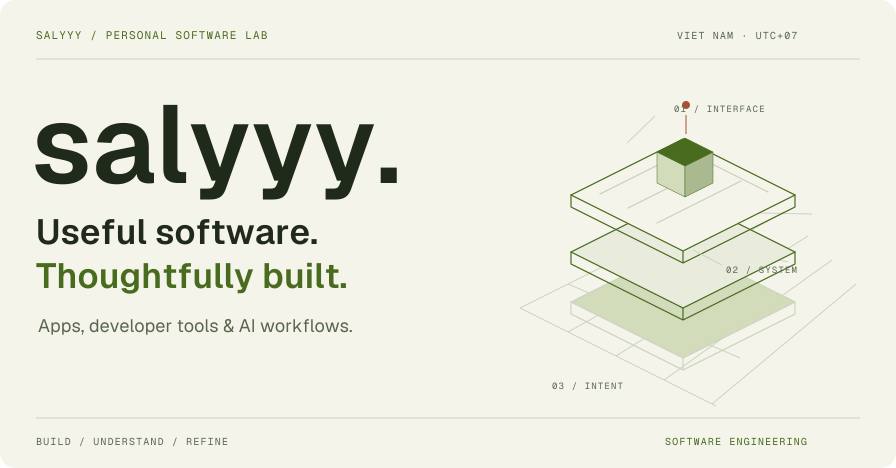
</picture>

<a href="https://salyyy.site/">Website</a> &nbsp; / &nbsp; <a href="https://discord.gg/WMFcNr23kJ">Discord</a> &nbsp; / &nbsp; <a href="https://github.com/SalyyS1?tab=repositories">Repositories</a>

I’m **Salyyy**, a software builder from **Viet Nam**. I work on desktop applications, developer tools and practical automation — with a growing focus on local-first software and AI-assisted workflows.

<picture>
<source media="(max-width: 600px) and (prefers-color-scheme: dark)" srcset="assets/focus-mobile.dark.svg">
<source media="(max-width: 600px)" srcset="assets/focus-mobile.light.svg">
<source media="(prefers-color-scheme: dark)" srcset="assets/focus.dark.svg">
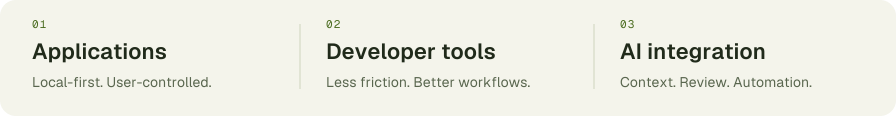
</picture>

<picture>
<source media="(max-width: 600px) and (prefers-color-scheme: dark)" srcset="assets/work-mobile.dark.svg">
<source media="(max-width: 600px)" srcset="assets/work-mobile.light.svg">
<source media="(prefers-color-scheme: dark)" srcset="assets/work.dark.svg">
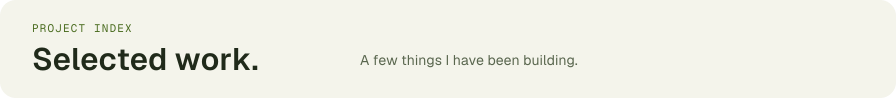
</picture>

<a href="https://github.com/SalyyS1/SLClean">
<picture>
<source media="(max-width: 600px) and (prefers-color-scheme: dark)" srcset="assets/project-1-mobile.dark.svg">
<source media="(max-width: 600px)" srcset="assets/project-1-mobile.light.svg">
<source media="(prefers-color-scheme: dark)" srcset="assets/project-1.dark.svg">
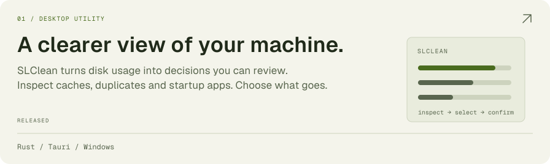
</picture>
</a>

<a href="https://github.com/SalyyS1/SLTerm">
<picture>
<source media="(prefers-color-scheme: dark)" srcset="assets/project-2.dark.svg">
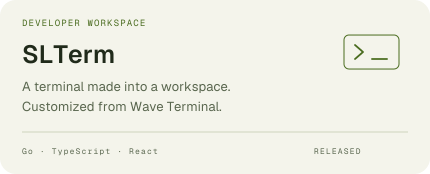
</picture>
</a>
<a href="https://github.com/SalyyS1/DiscordsRPC">
<picture>
<source media="(prefers-color-scheme: dark)" srcset="assets/project-3.dark.svg">
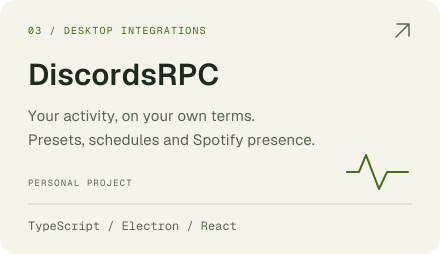
</picture>
</a>

<a href="https://github.com/SalyyS1/foliora">
<picture>
<source media="(prefers-color-scheme: dark)" srcset="assets/project-4.dark.svg">
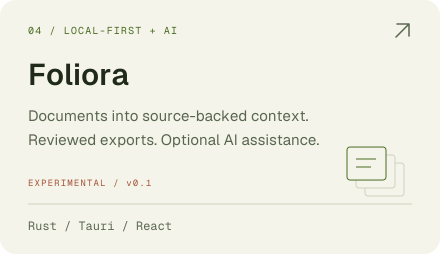
</picture>
</a>
<a href="https://github.com/SalyyS1/discord-bot">
<picture>
<source media="(prefers-color-scheme: dark)" srcset="assets/project-5.dark.svg">
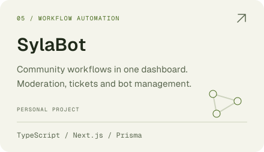
</picture>
</a>

Project notes &amp; engineering background

- **[SLClean](https://github.com/SalyyS1/SLClean)** — a Windows disk utility with review-before-delete controls; downloadable releases.
- **[SLTerm](https://github.com/SalyyS1/SLTerm)** — a customized workspace based on [Wave Terminal](https://github.com/wavetermdev/waveterm); upstream credit matters.
- **[DiscordsRPC](https://github.com/SalyyS1/DiscordsRPC)** — a personal desktop integration project for Discord and Spotify.
- **[Foliora](https://github.com/SalyyS1/foliora)** — an experimental context-pack application, with source-backed review and optional AI assistance. Its prerelease and release checklist describe current limits.
- **[SylaBot](https://github.com/SalyyS1/discord-bot)** — a personal bot/dashboard project; ongoing engineering work, not a production-readiness claim.

I also build in the Minecraft ecosystem. [minecraftkit](https://github.com/SalyyS1/minecraftkit) explores agent skills and API knowledge; [foliascan](https://github.com/SalyyS1/foliascan) explores bytecode analysis; [mcstage](https://github.com/SalyyS1/mcstage) explores integration tests against real servers.

<picture>
<source media="(max-width: 600px) and (prefers-color-scheme: dark)" srcset="assets/activity-mobile.dark.svg">
<source media="(max-width: 600px)" srcset="assets/activity-mobile.light.svg">
<source media="(prefers-color-scheme: dark)" srcset="assets/activity.dark.svg">
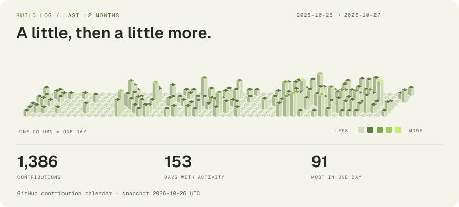
</picture>

<picture>
<source media="(max-width: 600px) and (prefers-color-scheme: dark)" srcset="assets/stack-mobile.dark.svg">
<source media="(max-width: 600px)" srcset="assets/stack-mobile.light.svg">
<source media="(prefers-color-scheme: dark)" srcset="assets/stack.dark.svg">
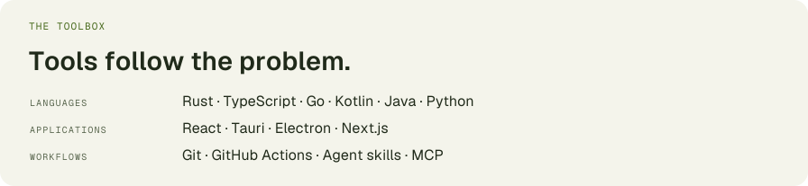
</picture>

<a href="https://github.com/SalyyS1?tab=repositories"><picture>
<source media="(max-width: 600px) and (prefers-color-scheme: dark)" srcset="assets/footer-mobile.dark.svg">
<source media="(max-width: 600px)" srcset="assets/footer-mobile.light.svg">
<source media="(prefers-color-scheme: dark)" srcset="assets/footer.dark.svg">
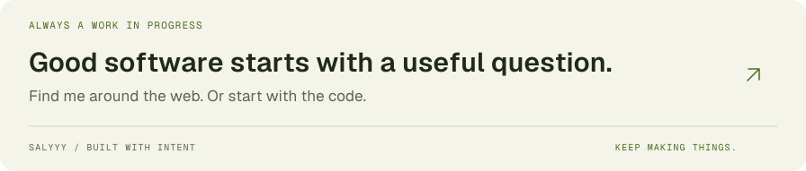
</picture></a>

<a href="https://discord.gg/WMFcNr23kJ">Discord · saly.0105</a> &nbsp; / &nbsp; <a href="https://www.facebook.com/saly.0105">Facebook</a> &nbsp; / &nbsp; <a href="https://www.instagram.com/saly_0105/">Instagram</a> &nbsp; / &nbsp; <a href="https://open.spotify.com/user/31d4qdaigoosddkp7kn47sfp6od4">Spotify</a>

About this profile

Original “Personal Software Lab” visual system. SVGs generated locally from GitHub data and refreshed by GitHub Actions. No external image service required. Calendar counts follow GitHub’s contribution calendar; repository metadata is public only.

Edit `profile.config.json`, then run `npm ci`, `npm run refresh` and `npm run check` with Node.js 22+ and an authenticated GitHub CLI. `npm run render` reuses the saved snapshot offline.

[Geist](https://github.com/vercel/geist-font) fonts use the [SIL Open Font License](design/fonts/OFL-Geist.txt). The SVG/Actions approach was inspired by [keepmeside](https://github.com/keepmeside); the artwork, layout and renderer here are original.

